# Estrutura Analítica do Projeto (EAP) — Projeto FieldOps

**Versão:** 1.0
**Data:** 2026-08-21
**Estado:** artefato histórico; o plano vigente e a fonte de requisitos estão no [mapa da documentação](../README.md), [diagnóstico](../_KB/99-reference/diagnostics/discovery.md) e [plano até novembro](../_KB/11-planning/mvp.md).
**Artefatos considerados:** especificação funcional (`fieldops-spec.md`), código-fonte e histórico de commits dos repositórios `API` e `interface-administrativa`, READMEs de cada repositório, estrutura da organização GitHub `Project-FielOps`.

A EAP decompõe o escopo total do Projeto FieldOps até o nível de pacotes de trabalho. Cada item indica também o **status atual**, levantado a partir do código e da documentação existentes — não apenas planejado, mas efetivamente verificado.

---

## 1. Diagrama (visão até o 2º nível)

```mermaid
graph TD
    A[1.0 Projeto FieldOps] --> B[1.1 Gestão do Projeto]
    A --> C[1.2 Levantamento e Modelagem]
    A --> D[1.3 API REST - Backend]
    A --> E[1.4 Interface Administrativa - Frontend]
    A --> F[1.5 Aplicativo Mobile]
    A --> G[1.6 Infraestrutura e DevOps]
    A --> H[1.7 Qualidade e Testes]
    A --> I[1.8 Documentação]
    A --> J[1.9 Encerramento]

    B --> B1[1.1.1 Iniciação / TAP]
    B --> B2[1.1.2 Planejamento / EAP e Cronograma]
    B --> B3[1.1.3 Monitoramento e Controle]
    B --> B4[1.1.4 Encerramento formal]

    C --> C1[1.2.1 Especificação funcional]
    C --> C2[1.2.2 Modelo de dados]
    C --> C3[1.2.3 Regras de negócio]
    C --> C4[1.2.4 Arquitetura]

    D --> D1[1.3.1 Infraestrutura base]
    D --> D2[1.3.2 Autenticação e autorização]
    D --> D3[1.3.3 Cadastros]
    D --> D4[1.3.4 Modelos de inspeção]
    D --> D5[1.3.5 Execução de inspeções]
    D --> D6[1.3.6 Evidências]
    D --> D7[1.3.7 Revisão e não conformidades]
    D --> D8[1.3.8 Auditoria e dashboard]
    D --> D9[1.3.9 Testes automatizados]
    D --> D10[1.3.10 Documentação da API]

    E --> E1[1.4.1 Infraestrutura base]
    E --> E2[1.4.2 Autenticação e guards]
    E --> E3[1.4.3 Módulo usuários]
    E --> E4[1.4.4 Cadastros: clientes/locais/equip.]
    E --> E5[1.4.5 Construtor de modelos]
    E --> E6[1.4.6 Planejamento e acompanhamento]
    E --> E7[1.4.7 Revisão de inspeções]
    E --> E8[1.4.8 Não conformidades]
    E --> E9[1.4.9 Auditoria e dashboard]
    E --> E10[1.4.10 Validação de integração]

    F --> F1[1.5.1 Setup Expo/React Native]
    F --> F2[1.5.2 Persistência local - SQLite]
    F --> F3[1.5.3 Execução offline]
    F --> F4[1.5.4 Evidências e QR Code]
    F --> F5[1.5.5 Sincronização]

    G --> G1[1.6.1 Ambiente de desenvolvimento]
    G --> G2[1.6.2 Configuração e segredos]
    G --> G3[1.6.3 CI/CD]
    G --> G4[1.6.4 Homologação / produção]

    H --> H1[1.7.1 Testes de integração backend]
    H --> H2[1.7.2 Testes frontend]
    H --> H3[1.7.3 Revisão de UI/UX]
    H --> H4[1.7.4 Testes manuais end-to-end]

    I --> I1[1.8.1 Especificação funcional]
    I --> I2[1.8.2 READMEs técnicos]
    I --> I3[1.8.3 Documentação de gestão]
    I --> I4[1.8.4 Board de acompanhamento]

    J --> J1[1.9.1 Homologação com stakeholders]
    J --> J2[1.9.2 Lições aprendidas]
    J --> J3[1.9.3 Entrega final]
```

> A EAP é ilustrativa até o pacote de trabalho; não representa 100% das tarefas atômicas de código, que estão detalhadas no cronograma (`../03-cronograma/cronograma-fieldops.md`).

---

## 2. Detalhamento por pacote de trabalho

Legenda de status: ✅ Concluído · 🔶 Parcial · ⛔ Não iniciado

### 1.1 Gestão do Projeto
| Código | Pacote de trabalho | Status |
|---|---|---|
| 1.1.1 | Termo de Abertura do Projeto (PII e produto) | ✅ |
| 1.1.2 | EAP e Cronograma | ✅ |
| 1.1.3 | Monitoramento e controle (board GitHub Projects #4) | 🔶 — board existe na organização, mas ainda não conciliado com este cronograma |
| 1.1.4 | Encerramento formal do projeto | ⛔ |

### 1.2 Levantamento e Modelagem
| Código | Pacote de trabalho | Status |
|---|---|---|
| 1.2.1 | Especificação funcional (Notion → `fieldops-spec.md`) | ✅ |
| 1.2.2 | Modelo de dados (15+ entidades, UUID, versionamento imutável, snapshots) | ✅ |
| 1.2.3 | Regras de negócio (RN-001 a RN-090) | ✅ |
| 1.2.4 | Arquitetura (camadas, contextos funcionais, diagrama) | ✅ |

### 1.3 API REST (Backend — Java/Spring Boot)
| Código | Pacote de trabalho | Status |
|---|---|---|
| 1.3.1 | Scaffold do projeto, config, Docker Compose, Flyway V1 | ✅ |
| 1.3.2 | Autenticação JWT, papéis, Spring Security | ✅ |
| 1.3.3 | Cadastros: usuários, clientes, locais, equipamentos | ✅ |
| 1.3.4 | Modelos de inspeção com versionamento imutável | ✅ |
| 1.3.5 | Ciclo de vida da inspeção (agendar → executar → submeter) | ✅ |
| 1.3.6 | Evidências (metadados; upload real ainda não implementado) | 🔶 |
| 1.3.7 | Revisão em ciclos e não conformidades | ✅ |
| 1.3.8 | Auditoria e indicadores de dashboard | ✅ |
| 1.3.9 | Testes de integração (auth, versionamento, fluxo completo) | ✅ |
| 1.3.10 | Documentação OpenAPI/Swagger | ✅ |
| 1.3.11 | Endpoints mobile (`/api/v1/mobile/**`) e sincronização | ⛔ — fora de escopo deste build |

### 1.4 Interface Administrativa (Frontend — Angular)
| Código | Pacote de trabalho | Status |
|---|---|---|
| 1.4.1 | Scaffold Angular standalone, layout (shell, sidenav) | ✅ |
| 1.4.2 | Autenticação (login, guards de rota e perfil) | ✅ |
| 1.4.3 | Módulo de usuários (ADMIN) | ✅ |
| 1.4.4 | Clientes, locais e equipamentos (com drill-down) | ✅ |
| 1.4.5 | Construtor de modelos de inspeção (seções, itens, publicação, versões) | ✅ |
| 1.4.6 | Planejamento e acompanhamento de inspeções | ✅ |
| 1.4.7 | Tela de revisão (aprovar/reprovar) | ✅ |
| 1.4.8 | Não conformidades (listagem) | ✅ |
| 1.4.9 | Auditoria (somente leitura) e dashboard | ✅ |
| 1.4.10 | Validação de integração contra a API real | ✅ — registrado no commit "fix: align frontend with the real backend API contract" |
| 1.4.11 | Upload de evidências pela interface web | ⛔ — decisão de escopo: evidências são capturadas no mobile |
| 1.4.12 | Refino visual / identidade de marca (além do tema Material padrão) | ⛔ |

### 1.5 Aplicativo Mobile (Expo/React Native)
| Código | Pacote de trabalho | Status |
|---|---|---|
| 1.5.1 | Setup do projeto Expo/React Native | ⛔ — repositório `aplicativo-mobile` criado, vazio |
| 1.5.2 | Persistência local (SQLite) | ⛔ |
| 1.5.3 | Execução offline de inspeções | ⛔ |
| 1.5.4 | Captura de evidências e leitura de QR Code | ⛔ |
| 1.5.5 | Sincronização (push/pull idempotente) | ⛔ |

### 1.6 Infraestrutura e DevOps
| Código | Pacote de trabalho | Status |
|---|---|---|
| 1.6.1 | Ambiente de desenvolvimento local (Docker Compose + Postgres) | ✅ |
| 1.6.2 | Gestão de configuração e segredos (variáveis de ambiente) | ✅ |
| 1.6.3 | Pipeline de CI/CD | ⛔ |
| 1.6.4 | Ambiente de homologação/produção | ⛔ |

### 1.7 Qualidade e Testes
| Código | Pacote de trabalho | Status |
|---|---|---|
| 1.7.1 | Testes de integração do backend (Testcontainers) | ✅ |
| 1.7.2 | Testes automatizados do frontend | ⛔ |
| 1.7.3 | Revisão de UI/UX da interface administrativa | ⛔ |
| 1.7.4 | Testes manuais ponta a ponta (com backend + frontend rodando) | 🔶 |

### 1.8 Documentação
| Código | Pacote de trabalho | Status |
|---|---|---|
| 1.8.1 | Especificação funcional consolidada | ✅ |
| 1.8.2 | READMEs técnicos (API e frontend) | ✅ |
| 1.8.3 | Documentação de gestão (TAP, EAP, cronograma — este repositório) | ✅ |
| 1.8.4 | Board de acompanhamento (GitHub Projects #4) atualizado e conciliado | ⛔ |

### 1.9 Encerramento
| Código | Pacote de trabalho | Status |
|---|---|---|
| 1.9.1 | Homologação com stakeholders (apresentação/demo) | ⛔ |
| 1.9.2 | Registro de lições aprendidas | ⛔ |
| 1.9.3 | Entrega final e encerramento formal do PII | ⛔ |

---

## 3. Observações

- Os ramos **1.3 (API)** e **1.4 (Interface Administrativa)** representam a maior parte do escopo já entregue e verificado diretamente no código dos repositórios `API` e `interface-administrativa`.
- O ramo **1.5 (Mobile)** está integralmente pendente — o repositório existe, mas sem conteúdo.
- Os ramos **1.6 (DevOps)**, **1.7 (Qualidade)**, **1.8 (Documentação)** e **1.9 (Encerramento)** têm itens concluídos e itens pendentes; são o foco natural da próxima fase do cronograma.
