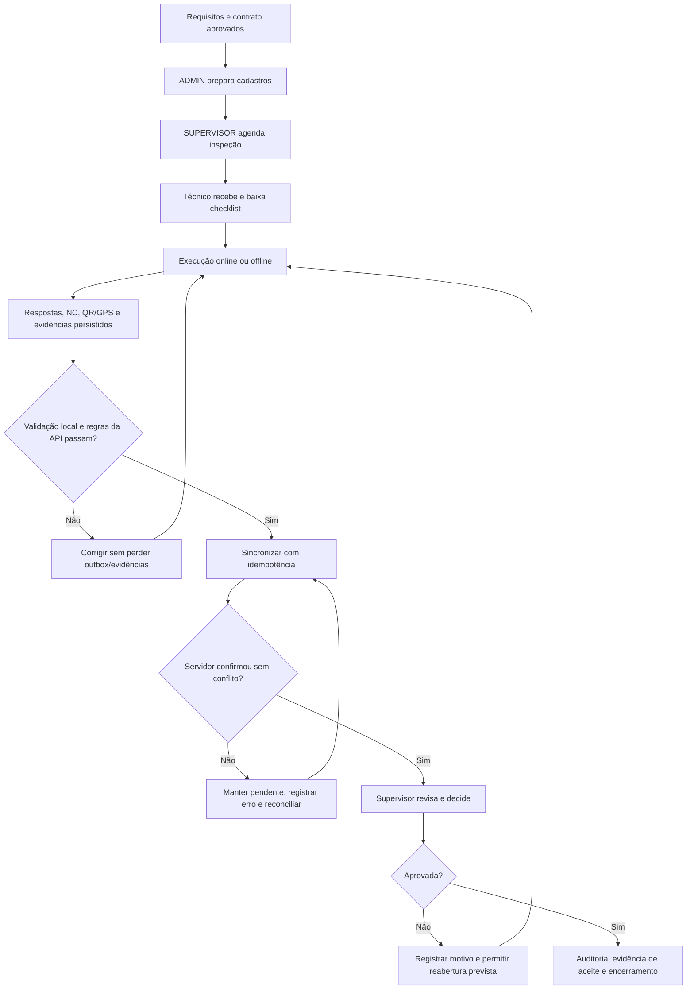

# Orçamento e análise da qualidade — Projeto FieldOps

**Versão:** 1.0  
**Data-base:** 27/09/2026  
**Natureza:** estimativa acadêmica para planejamento; não é proposta comercial nem registro de gastos realizados.

## 1. Objetivo e base da estimativa

Este documento reúne o plano de gerenciamento dos custos, a estimativa de três pontos, o orçamento de referência e a aplicação das sete ferramentas básicas da qualidade ao FieldOps. O escopo de referência é o MVP integrado descrito na documentação do projeto: API, painel administrativo, aplicativo mobile, qualidade, infraestrutura, documentação e encerramento.

Foram considerados a EAP, o cronograma de 65 atividades, o plano vigente até novembro de 2026, a estratégia de testes, a documentação de qualidade e o plano de integração do MVP. O cronograma legado aponta encerramento em outubro, enquanto o plano vigente estende o trabalho até novembro; para este orçamento prevalecem o escopo integrado e o horizonte vigente de novembro. As datas e os status do cronograma devem ser conciliados antes de servirem como linha de base oficial.

As fontes não informam horas efetivamente trabalhadas, tarifas contratadas, notas fiscais, consumo de nuvem ou resultados de testes em série. Portanto, os valores abaixo são premissas explícitas de custo de reposição de equipe, não despesas observadas. O orçamento deve ser recalibrado com a composição real da equipe, cotações de nuvem e apontamentos de horas.

## 2. Premissas e limites

| Premissa | Valor adotado | Como revisar |
|---|---:|---|
| Unidade de esforço | 1 pessoa-dia = 6 horas produtivas | Substituir por apontamento real da equipe |
| Tarifas carregadas de referência | Por papel, conforme a tabela de estimativa | Validar com remuneração/mercado local; inclui encargos estimados, não é salário líquido |
| Cenários de esforço | Otimista, mais provável e pessimista por pacote | Reestimar quando contratos e desenho mobile estiverem fechados |
| Nuvem e serviços externos | Provisão de R$ 800 / R$ 1.500 / R$ 4.000 para três meses | Validar na calculadora AWS e com créditos acadêmicos antes de provisionar |
| Ferramentas de desenvolvimento | Preferência por ferramentas gratuitas/open source | Acrescentar licenças pagas somente após cotação e aprovação |
| Tributos, aquisição de dispositivos e operação após entrega | Não incluídos | Orçar separadamente quando houver decisão de produção |
| Escopo | MVP integrado, incluindo trabalho já executado e ainda pendente | Não representa saldo a gastar a partir da data-base |

O custo de equipe é uma valoração econômica do esforço. Em um projeto acadêmico com trabalho voluntário, o desembolso financeiro pode ser menor, mas não se deve interpretar isso como custo total igual a zero. A provisão de nuvem é indicativa e não autoriza criar recursos pagos.

## 3. Gerenciamento dos custos do projeto

### 3.1 Planejar o gerenciamento dos custos

- **Unidade e precisão:** estimar esforço em pessoa-dias e custo em reais; arredondar o orçamento para reais inteiros. Incerteza atual da estimativa: alta, aproximadamente -20% a +35%, a ser reduzida após contratos, horas e cotações.
- **Responsabilidades:** gerente do projeto mantém a linha de base e o registro de mudanças; responsáveis técnicos estimam e apontam esforço; equipe valida entregáveis; patrocinador/professor aprova mudanças de escopo e reservas conforme governança acadêmica. As fontes não confirmam nomes individuais para todos esses papéis.
- **Registro:** manter estimativa por pacote da EAP, premissa, responsável, realizado, saldo, previsão no término e justificativa de variação. Guardar comprovantes de despesas reais separados do valor econômico de mão de obra.
- **Aprovação:** só incorporar mudança de escopo ou de linha de base após registrar impacto em prazo, custo, qualidade e aceite. Reestimativas não apagam a linha de base anterior.
- **Periodicidade:** atualizar esforço e compromissos semanalmente e revisar previsão/reservas a cada marco ou quando houver mudança relevante.
- **Limite de controle:** variação superior a 10% do pacote, previsão acima da linha de base ou consumo de reserva exige análise de causa e decisão registrada do gerente e patrocinador.
- **Controle de mudança:** a reserva gerencial não é autorização automática. O gerente solicita seu uso ao patrocinador e atualiza a previsão e o histórico da decisão.

### 3.2 Estimar os custos e estimativa de três pontos

Aplicou-se estimativa análoga/paramétrica por pacote da EAP, usando a sequência de atividades e as incertezas explicitadas nos documentos. Para cada linha, o esforço esperado usa PERT:

$$E = \frac{cO + 4cM + cP}{6}$$

O custo esperado é $E$ multiplicado pela tarifa diária assumida. Para nuvem, os três pontos são valores diretos estimados, sem multiplicação por dias.

| Pacote de trabalho / papel de referência | cO (dias ou R$) | cM (dias ou R$) | cP (dias ou R$) | Tarifa por pessoa-dia | Custo esperado |
|---|---:|---:|---:|---:|---:|
| Gestão, planejamento e encerramento — gerente de projeto | 8 dias | 10 dias | 14 dias | R$ 450 | R$ 4.650 |
| Requisitos, regras, arquitetura e dados — analista/arquitetura | 9 dias | 12 dias | 16 dias | R$ 420 | R$ 5.110 |
| API, regras de domínio e contratos de integração — backend | 22 dias | 28 dias | 38 dias | R$ 500 | R$ 14.333 |
| Painel administrativo — frontend | 18 dias | 24 dias | 32 dias | R$ 460 | R$ 11.193 |
| Aplicativo mobile offline, sync, QR e evidências — mobile | 24 dias | 32 dias | 46 dias | R$ 500 | R$ 16.500 |
| Testes, revisão, homologação e acessibilidade — QA | 9 dias | 14 dias | 22 dias | R$ 380 | R$ 5.510 |
| CI/CD, ambientes e armazenamento — DevOps | 5 dias | 8 dias | 14 dias | R$ 520 | R$ 4.420 |
| Documentação e apoio à entrega — documentação | 6 dias | 8 dias | 12 dias | R$ 320 | R$ 2.667 |
| Nuvem e serviços externos, por três meses | R$ 800 | R$ 1.500 | R$ 4.000 | Não se aplica | R$ 1.800 |
| **Total estimado (cO / cM / cP / esperado)** | **R$ 47.400** | **R$ 64.120** | **R$ 93.220** | — | **R$ 66.183** |

Os cenários de custo total combinam os cenários de cada pacote e são referências de planejamento; não são intervalos probabilísticos independentes. O esperado consolidado é a soma dos valores PERT por pacote, arredondados apenas na apresentação. Tarifas e esforço não foram confirmados por contratos ou apontamentos históricos.

### 3.3 Determinar o orçamento

| Componente | Cálculo | Valor |
|---|---|---:|
| Estimativa de custo esperada | Soma dos custos esperados dos pacotes | R$ 66.183 |
| Reserva de contingência | 15% da estimativa para riscos identificados | R$ 9.927 |
| **Linha de base de custos** | Estimativa + contingência | **R$ 76.110** |
| Reserva gerencial | 5% da estimativa esperada; fora da linha de base | R$ 3.309 |
| **Orçamento total de referência** | Linha de base + reserva gerencial | **R$ 79.419** |

A reserva de contingência cobre riscos conhecidos, sobretudo integração mobile/API, retrabalho de sync e upload, autorização, testes e variação de consumo de nuvem. A reserva gerencial cobre incertezas não identificadas e só pode ser usada mediante aprovação. O orçamento total não é uma autorização de gasto nem uma cotação de mercado.

### 3.4 Controlar os custos

No fechamento semanal, comparar custo planejado, custo efetivamente incorrido e valor do trabalho concluído por pacote. Registrar horas em pessoa-horas e despesas por comprovante. Atualizar o custo previsto para terminar e a previsão no término; não tratar atividade “concluída” no cronograma como comprovação de horas ou desembolso.

Quando houver apontamento confiável, usar gerenciamento do valor agregado: $CV = EV - AC$, $SV = EV - PV$, $CPI = EV/AC$ e $SPI = EV/PV$, em que EV é valor agregado, AC é custo real e PV é valor planejado. No momento, não há dados de AC nem critérios quantitativos completos para EV; logo, não é possível calcular índices reais. Para a nuvem, ativar alertas de orçamento e revisar consumo semanalmente antes de permitir expansão de recursos.

## 4. Atividade de custos

**Exercício de controle:** ao fim de um pacote cuja linha de base aprovada é R$ 10.000, o realizado é R$ 6.000 e o valor do trabalho aceito é R$ 5.000. Então $CV = 5.000 - 6.000 = -R$ 1.000$ e $CPI = 5.000/6.000 = 0,83$. O pacote está acima do custo para o trabalho aceito; não se deve simplesmente consumir contingência sem identificar a causa, atualizar a previsão e aprovar a resposta.

**Aplicação ao FieldOps:** antes de estimar o custo restante, reconciliar atividades/status do cronograma com a EAP; estimar separadamente o trabalho mobile e as lacunas P0 de integração; obter tarifas acordadas; e cotar a infraestrutura. Sem essas entradas, o exercício acima é didático e o orçamento permanece uma referência preliminar.

## 5. Gerenciamento da qualidade do projeto

Para o FieldOps, qualidade significa atender requisitos e critérios de aceite observáveis, prevenir defeitos por validação antecipada, melhorar o processo por ciclos de teste e acompanhar resultados com evidências. Relevam especialmente autorização por papel e vínculo, integridade do checklist e das respostas, operação offline, sincronização sem perda/duplicidade, revisão rastreável, proteção de evidências e implantação reproduzível.

Os gates de qualidade devem vincular cada teste a requisito/regra/critério de aceite, registrar versão e ambiente, resultado e evidência, e manter defeitos com severidade e responsável. Um item só é aceito após execução observável; existência de código ou de documentação não equivale a validação. A estratégia existente recomenda testes de integração no backend, testes de guards/formulários/estados no painel e cenários em dispositivo para persistência, QR, GPS, outbox e conflitos no mobile.

**Evidência atual importante:** a EAP registra testes de integração do backend como concluídos, testes automatizados do frontend como pendentes e testes manuais ponta a ponta como parciais. O plano integrado lista 12 lacunas de integração G01–G12 e 18 tarefas P0, ainda sem aceite integrado documentado. Essa contagem é inventário documental, não taxa de defeitos em produção.

## 6. Aplicação das Sete Ferramentas Básicas da Qualidade

### 6.1 Diagrama de causa e efeito

**Efeito analisado:** risco de o MVP não concluir uma inspeção integrada, offline e auditável de ponta a ponta.

| Ramo | Causas sustentadas pelos documentos |
|---|---|
| Pessoas | Responsáveis nominais e capacidade disponível não estão atribuídos por pacote; a aprovação do TAP/patrocinador ainda precisa ser confirmada. |
| Processo | Cronograma legado e plano vigente divergem no horizonte; status de atividades precisam ser conciliados; não há apontamento de horas nem evidência de aceite ponta a ponta. |
| Tecnologia/API | Feed de mudanças remotas, atribuíveis por papel, dados de QR/GPS, NC offline e idempotência de upload são lacunas P0 descritas em G01–G07. |
| Aplicativo mobile | O app está em desenvolvimento planejado; persistência, checklist dinâmico, upload e sincronização real ainda não têm validação evidenciada (G08–G09). |
| Painel | Há falhas documentadas em planejamento por papel, revisão de evidências/sessão e ações de estado (G03, G10–G11). |
| Medição/documentação | Não há série de falhas, tempos, retrabalho ou custos reais; há documentos legados de sync que podem conflitar com o contrato vigente (G12). |

**Conclusão:** o risco é sistêmico, não atribuível a um único componente. Priorizar contrato/API e integração de fluxos antes de polimento visual, e instituir evidência de execução e reconciliação de status. As causas são hipóteses apoiadas pelos registros existentes; devem ser confirmadas em revisão técnica e testes.

### 6.2 Fluxograma

Fluxo de aceite que torna explícitos os pontos de controle e retorno para correção:



**Conclusão:** aceite não deve ocorrer ao concluir localmente; depende de confirmação do servidor, revisão autorizada e evidência rastreável. O fluxo destaca os caminhos que os testes P0 devem cobrir.

### 6.3 Folha de verificação

A folha abaixo é uma verificação documental dos grupos de lacunas já registrados no plano de integração. Cada ocorrência é um item G listado uma vez; não representa incidência em usuários, execuções ou versões.

| Grupo de verificação documental | Referências | Contagem de lacunas registradas |
|---|---|---:|
| API, integração, autorização e evidências | G01, G02, G04, G05, G06, G07 | 6 |
| Painel administrativo | G03, G10, G11 | 3 |
| Mobile e experiência de execução | G08, G09 | 2 |
| Documentação/contrato | G12 | 1 |
| **Total inventariado** | **G01–G12** | **12** |

Para a execução real de QA, duplicar a folha por build/ciclo e registrar requisito, ambiente/dispositivo, cenário, passou/falhou/bloqueado, severidade, evidência e defeito. Até que existam execuções registradas, os campos de resultado real ficam “não medido”, nunca zero.

### 6.4 Diagrama de Pareto

Pareto do inventário G01–G12, agrupado pela área primária registrada. Percentuais calculados sobre 12 lacunas documentadas:

| Ordem | Área | Lacunas | Percentual | Acumulado |
|---:|---|---:|---:|---:|
| 1 | API/integração/autorização/evidências | 6 | 50,0% | 50,0% |
| 2 | Painel administrativo | 3 | 25,0% | 75,0% |
| 3 | Mobile/execução | 2 | 16,7% | 91,7% |
| 4 | Documentação/contrato | 1 | 8,3% | 100,0% |

```text
API/integração  ██████  6
Painel          ███     3
Mobile          ██      2
Documentação    █       1
```

**Conclusão:** API/integração e painel concentram 75% do inventário; incluir autorização e idempotência nos primeiros gates reduz riscos transversais. O resultado prioriza trabalho, mas não demonstra que essas áreas tenham maior taxa de falha: a unidade é “lacuna listada”, e categorias dependem da classificação documental.

### 6.5 Histograma

Como não há uma série de defeitos medidos, usa-se a distribuição disponível de duração planejada das 65 atividades do cronograma legado. Ela informa sobre o próprio planejamento, não sobre a qualidade entregue.

| Duração planejada por atividade | Frequência | Frequência relativa |
|---|---:|---:|
| 1 dia | 42 | 64,6% |
| 2 dias | 16 | 24,6% |
| 3 dias | 5 | 7,7% |
| 4 dias | 2 | 3,1% |
| **Total** | **65** | **100,0%** |

```text
1 dia   ██████████████████████████████████████████ 42
2 dias  ████████████████                           16
3 dias  █████                                        5
4 dias  ██                                           2
```

**Conclusão:** 89,2% das atividades têm duração planejada de um ou dois dias. Isso sinaliza granularidade curta, mas também risco de subestimar integração, testes e retrabalho; não comprova duração real nem defeitos. Para um histograma de qualidade, coletar tempo de ciclo ou defeitos por execução/build e definir faixas antes de interpretar a distribuição.

### 6.6 Gráfico de controle

**Situação dos dados:** não há medições repetidas por build/ciclo nem sequência temporal de defeitos, falhas ou duração. Portanto, limites de controle e estabilidade estatística não podem ser calculados sem inventar uma série.

**Aplicação proposta:** em cada build integrada, registrar a proporção de cenários P0 reprovados ($p = falhas/cenários executados$), mantendo denominador e escopo comparáveis. Após pelo menos 20 ciclos comparáveis, avaliar gráfico p e limites de controle; investigar pontos fora dos limites ou padrões não aleatórios. Separar mudanças de escopo e não misturar testes bloqueados com aprovados. O limiar de aceite continua sendo o critério funcional do projeto, não o limite estatístico.

**Conclusão:** hoje a equipe consegue identificar lacunas conhecidas, mas não afirmar estabilidade ou tendência de melhoria. A série por build é uma ação de medição para o gate QA-01.

### 6.7 Diagrama de dispersão

**Situação dos dados:** não existe conjunto pareado de observações (por exemplo, tamanho da mudança e defeitos encontrados, ou duração real e retrabalho) para o FieldOps. Não se pode afirmar correlação causal ou associação estatística.

**Aplicação proposta:** após cada sprint/build, registrar por pacote tanto o tamanho da mudança (por exemplo, arquivos alterados ou pontos de função definidos consistentemente) quanto defeitos encontrados em testes/homologação. Plotar um ponto por pacote/build, identificar valores atípicos e calcular associação apenas com amostra suficiente; controlar diferenças de criticidade e cobertura de teste. Alternativa operacional: duração real versus retrabalho, com definição estável de retrabalho.

**Conclusão:** a documentação revela riscos e lacunas, mas não permite dizer que pacotes maiores falham mais. Essa pergunta só pode ser respondida depois da coleta padronizada.

## 7. Atividade de qualidade

1. **Aplicação:** executar o fluxo do diagrama com uma inspeção válida em dispositivo e painel, incluindo modo offline, reinício do app, NC, foto, sincronização, revisão e reprovação/reabertura.
2. **Folha:** por etapa, registrar requisito/critério, resultado, versão, ambiente, evidência e defeito. Falha de execução fica distinta de bloqueio ambiental.
3. **Análise:** atualizar semanalmente o Pareto por defeitos observados e manter separada a contagem do inventário G01–G12; não somar evidência documental e falhas reais.
4. **Distribuição e estabilidade:** construir histograma de duração real e gráfico de controle da taxa de falha depois de acumular ciclos comparáveis; não usar os limites estatísticos como substitutos dos critérios de aceite.
5. **Relação entre variáveis:** coletar dados pareados para dispersão, explicitar unidade, tamanho da amostra e fatores de confusão, evitando inferir causalidade.
6. **Conclusão atual:** o backend tem testes de integração registrados como concluídos, mas frontend, mobile e jornada integrada têm lacunas explícitas. A evidência atual sustenta priorização de API/integração e painel; ainda não sustenta uma conclusão estatística sobre a qualidade operacional do produto.

## 8. Referências do projeto

- [EAP FieldOps](../02-eap/eap-fieldops.md)
- [Cronograma FieldOps](../03-cronograma/cronograma-fieldops.md)
- [_KB/10-quality/testing-strategy.md](../_KB/10-quality/testing-strategy.md)
- [_KB/10-quality/quality.md](../_KB/10-quality/quality.md)
- [_KB/11-planning/mvp.md](../_KB/11-planning/mvp.md)
- [_KB/11-planning/mvp-integration-plan.md](../_KB/11-planning/mvp-integration-plan.md)
- [_KB/01-product/product-overview.md](../_KB/01-product/product-overview.md)