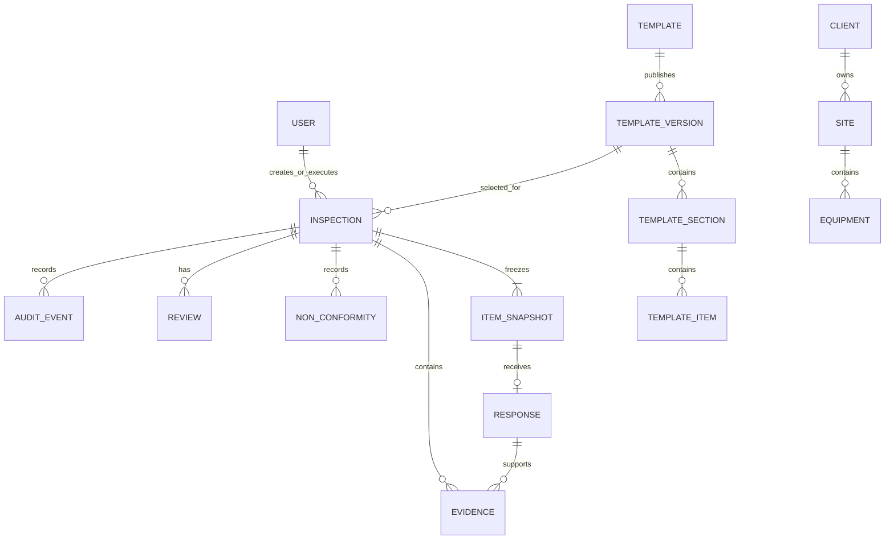

# Modelo conceitual de dados

Fonte normativa: capítulo 10 textual e DEC-001. A migração SQL é o estado físico observado; diferenças estão no [diagnóstico](../99-reference/diagnostics/discovery.md).

## Invariantes

- UUID identifica entidades sincronizáveis; e-mail e QR são únicos.
- Local pertence a cliente; equipamento pertence a local; inspeção mantém esses vínculos consistentes.
- Versão publicada e snapshot são imutáveis; item do snapshot tem no máximo uma resposta atual.
- Evidência sempre pertence a inspeção e pode apontar para resposta ou NC. Arquivos ficam fora do PostgreSQL; metadados ficam no banco.
- NC pertence à inspeção. No MVP seu status inicial é `OPEN`; tratamento completo é futuro.
- Revisão é histórica por ciclo. Auditoria registra transições críticas; não é substituída por campos `approved_by`.
- Estado de negócio da inspeção é separado do estado local de sync.

## Entidades e responsabilidade

`User`, `Client`, `InspectionSite`, `Equipment`, `InspectionTemplate`, `InspectionTemplateVersion`, `TemplateSection`, `TemplateItem`, `Inspection`, `InspectionItemSnapshot`, `InspectionResponse`, `Evidence`, `NonConformity`, `InspectionReview` e `AuditEvent` são centrais. `SyncOperation` e `SyncMetadata` existem somente no SQLite do app mobile. `EquipmentType`, opções normalizadas e entidades de comentários/ações do diagrama não fazem parte do modelo oficial do MVP.

Exclusão comum é inativação para cadastros; inspeções, snapshots, respostas sincronizadas, revisões e auditoria são preservados. Campos físicos definitivos só devem ser alterados por migração registrada após reconciliar código e contrato.
