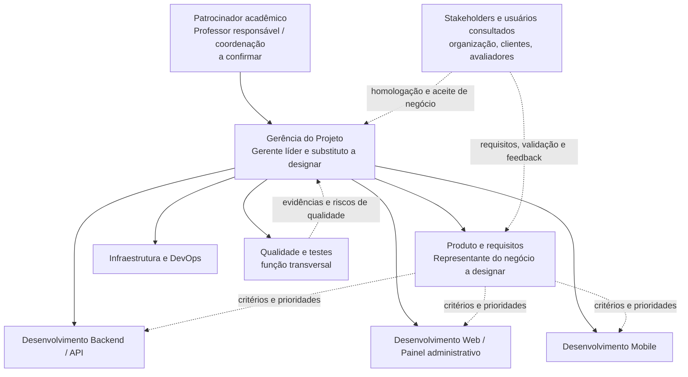

# Organograma e Matriz RACI — Projeto FieldOps

**Versão:** 1.0  
**Data:** 2026-09-27  
**Status:** proposta baseada na documentação disponível; atribuições nominais e aprovação formal pendentes.

## 1. Objetivo e base documental

Este documento organiza a estrutura de governança e a distribuição de responsabilidades do Projeto FieldOps. A proposta cruza a EAP, o cronograma, a documentação de stakeholders e papéis do produto, os compromissos acadêmicos e o plano integrado do MVP.

A documentação identifica funções como gerente do projeto, patrocinador, desenvolvimento backend/frontend/mobile e equipe de qualidade. Não identifica uma pessoa responsável por cada função ou pacote. O TAP lista Victor Toledo, José Eduardo, Giovani Miomoto, Luciano Menezes e Tobias Perassi como gerentes, mas não discrimina gerente líder, divisão de atribuições ou autoridade de aprovação. Por isso, a matriz usa papéis, não nomes inventados.

## 2. Organograma proposto

### Interpretação da estrutura

- **Patrocinador acadêmico:** autoridade proposta para aprovar TAP, mudanças relevantes de escopo e aceite final do PII. O professor responsável/coordenação aparece como patrocinador a validar; o TAP consultado não contém assinatura nem data de aprovação.
- **Gerência do Projeto (GP):** coordena planejamento, EAP, cronograma, custos, riscos, comunicação, dependências, mudanças e encerramento. O cronograma atribui estas atividades ao papel “Gerente do Projeto”.
- **Produto e requisitos (PROD):** papel funcional necessário para consolidar requisitos e critérios de aceite com os usuários. A documentação não nomeia Product Owner nem representante formal do negócio; a designação é pendência, não fato existente.
- **Backend/API, Web, Mobile e Infraestrutura/DevOps:** responsáveis técnicos por suas frentes, conforme EAP e cronograma. Os papéis “Dev Backend”, “Dev Frontend” e “Dev Mobile” são explícitos no cronograma; DevOps/infraestrutura aparece como equipe ou responsável de backend conforme a atividade.
- **Qualidade e testes (QA):** função transversal para estratégia, execução, evidências, triagem e reporte de qualidade. Os documentos identificam equipe de qualidade/testes, mas não seu integrante líder.
- **Stakeholders e usuários:** organização prestadora, clientes atendidos, equipe de desenvolvimento, avaliadores e usuários operacionais. Participam por consulta, validação e feedback, sem substituir a autoridade formal do patrocinador.

**Pessoas citadas no TAP:** Victor Toledo, José Eduardo, Giovani Miomoto, Luciano Menezes e Tobias Perassi. Permanecem associados ao grupo de gerentes registrado no TAP; não é possível distribuir entre GP, líderes técnicos ou aprovadores sem confirmação da equipe.

## 3. Papéis da Matriz RACI

| Sigla | Papel | Situação na documentação |
|---|---|---|
| PAT | Patrocinador acadêmico / professor responsável | Função prevista; nome, aprovação e autoridade formal precisam ser confirmados. |
| GP | Gerente do Projeto | Função usada na EAP e no cronograma; gerente líder e substituto não discriminados. |
| PROD | Responsável por produto/requisitos e representante do negócio | Necessidade funcional proposta; pessoa e autoridade de aceite de requisitos ainda não designadas. |
| BE | Desenvolvimento Backend / API | Papel identificado no cronograma; pessoa não indicada. |
| WEB | Desenvolvimento Web / Painel administrativo | Papel identificado como Dev Frontend no cronograma; pessoa não indicada. |
| MOB | Desenvolvimento Mobile | Papel identificado no cronograma; pessoa não indicada. |
| OPS | Infraestrutura / DevOps | Atividades previstas na EAP e no cronograma; responsável nominal e divisão com Backend pendentes. |
| QA | Qualidade e testes | Equipe identificada nos stakeholders e estratégia de testes; liderança nominal não indicada. |
| STK | Stakeholders e usuários envolvidos | Grupo organizacional identificado; representantes para consulta e homologação devem ser escolhidos. |

## 4. Matriz RACI

**R** = executa o trabalho (*Responsible*); **A** = responde pelo resultado e pela decisão final (*Accountable*); **C** = consultado antes ou durante a execução (*Consulted*); **I** = informado sobre andamento ou decisão (*Informed*); **—** = sem participação direta prevista. Cada atividade tem exatamente um papel **A**. Um papel pode acumular **R/A** quando executa e responde pelo resultado especializado.

| Atividade / pacote de trabalho | PAT | GP | PROD | BE | WEB | MOB | OPS | QA | STK |
|---|---|---|---|---|---|---|---|---|---|
| Elaborar TAP, definir objetivo e propor escopo | A | R | C | I | I | I | I | C | C |
| Aprovar TAP e mudanças relevantes de escopo | A | R | C | C | C | C | C | C | I |
| Levantar requisitos, regras de negócio e critérios de aceite | C | C | A/R | C | C | C | I | C | C |
| Elaborar e manter EAP, cronograma, orçamento e riscos | C | A/R | C | C | C | C | C | C | I |
| Definir arquitetura, contratos e integração técnica | I | C | C | A/R | C | C | C | C | I |
| Implementar e manter API/backend | I | C | C | A/R | C | C | C | C | I |
| Implementar e manter painel administrativo web | I | C | C | C | A/R | I | I | C | I |
| Implementar aplicativo mobile, operação offline e sincronização | I | C | C | C | I | A/R | C | C | I |
| Configurar AWS, ambientes, CI/CD e armazenamento | I | C | I | C | I | C | A/R | C | I |
| Definir estratégia, casos e critérios de teste | I | A | C | C | C | C | C | R | C |
| Executar testes por componente e registrar evidências | I | I | C | R | R | R | C | A | I |
| Executar validação integrada e homologação do fluxo MVP | C | R | C | R | R | R | C | R | A |
| Revisar documentação técnica e de gestão | I | A | C | R | R | R | R | C | I |
| Monitorar progresso, comunicar status e controlar mudanças | C | A/R | I | I | I | I | I | C | I |
| Conduzir entrega, lições aprendidas e encerramento do PII | A | R | C | C | C | C | C | C | C |

### Critério de leitura e limites

- O **A** de homologação integrada está atribuído ao grupo de stakeholders/usuários como proposta de aceite operacional do produto. O **PAT** mantém a aprovação acadêmica e o encerramento formal do PII; as duas decisões não são equivalentes.
- O **GP** responde pela coordenação do plano e dos controles, mas não substitui responsáveis técnicos pela qualidade de implementação.
- Em requisitos, a célula **PROD A/R** expressa que o papel proposto consolida e responde por essa entrega. Como não há Product Owner/representante formal nomeado, esse **A** só se torna efetivo após designação.
- A função QA responde pelos critérios e evidências de qualidade. As equipes técnicas executam testes de componente e corrigem defeitos em seus próprios módulos.
- Os papéis de usuário do sistema (ADMIN, SUPERVISOR, TECHNICIAN e CLIENT_VIEWER) não são cargos da equipe do projeto e, portanto, não são colunas RACI. São personas/perfis operacionais; representantes reais podem participar como STK.
- A classificação é uma proposta de governança. Não altera a regra de autorização do produto: somente o supervisor atribuído revisa inspeções no seu escopo; o técnico atribuído executa as inspeções designadas.

## 5. Pendências para aprovação da matriz

1. Confirmar patrocinador/professor responsável e registrar aprovação do TAP.
2. Designar gerente líder e substituto entre os nomes listados no TAP, com autoridade e disponibilidade explícitas.
3. Nomear representante de produto/negócio com autoridade para priorizar requisitos e validar critérios de aceite.
4. Atribuir pessoas responsáveis por Backend, Web, Mobile, Infraestrutura/DevOps e Qualidade; esclarecer a sobreposição entre DevOps e Backend.
5. Indicar representantes da organização prestadora, dos usuários técnicos/supervisores e dos avaliadores para consulta e homologação.
6. Aprovar formalmente quem tem o **A** no aceite operacional integrado e separar esse aceite da aprovação acadêmica do PII.
7. Após validação, substituir siglas por nomes no plano de execução/board e revisar a matriz em cada mudança de equipe ou escopo.

## 6. Referências

- [EAP FieldOps](../../02-eap/eap-fieldops.md)
- [Cronograma FieldOps](../../03-cronograma/cronograma-fieldops.md)
- [Stakeholders](../00-overview/stakeholders.md)
- [Papéis e permissões do produto](../01-product/user-roles.md)
- [Visão do produto](../01-product/product-overview.md)
- [Compromissos acadêmicos e calendário](academic.md)
- [Plano integrado de pendências do MVP](mvp-integration-plan.md)