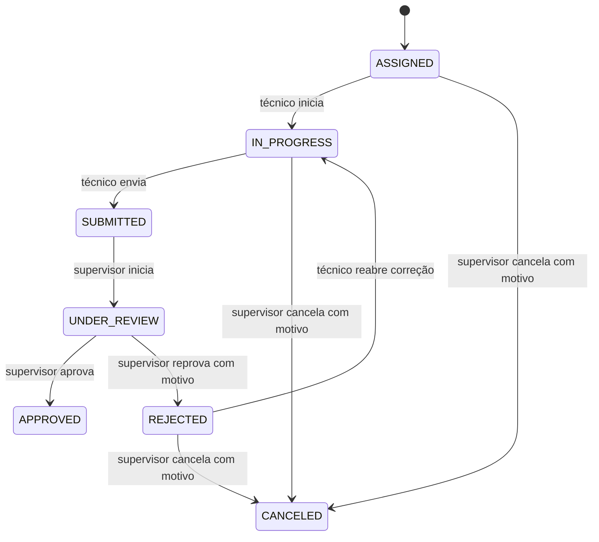

# Decisões arquiteturais

## DEC-001 Fonte de verdade do MVP

**Status:** aprovada em 2026-09-05. As regras textuais e decisões consolidadas da base `base_fieldops` definem produto e MVP. O diagrama e a ficha são históricos; o código divergente é pendência. Perfis oficiais são `ADMIN`, `SUPERVISOR`, `TECHNICIAN` e `CLIENT_VIEWER` futuro. Estados persistidos usam os valores ingleses do contrato observado, com `ASSIGNED` incluído.

## DEC-002 Autorização por responsável

**Status:** aprovada em 2026-09-05. No MVP, somente o técnico atribuído inicia, responde, adiciona evidências e conclui sua inspeção; somente o supervisor atribuído inicia revisão e decide. ADMIN mantém acessos/cadastros e não recebe exceção operacional. A API é a autoridade; guards e menus são apenas ergonomia. O código atual que admite ADMIN ou supervisor não atribuído deve ser corrigido e coberto por testes.

## DEC-003 Correção após reprovação

**Status:** aprovada em 2026-09-05. `REJECTED` pode ser reaberta por ação explícita para `IN_PROGRESS`; o técnico atribuído corrige o checklist inteiro e reenvia. Respostas anteriores permanecem auditáveis; a regra de liberar somente itens indicados fica para P1. A transição exige o supervisor atribuído e não permite alteração silenciosa de respostas pelo supervisor.

## DEC-008 Prazo e cloud

**Status:** aprovada em 2026-09-05. A entrega acadêmica deve ocorrer até o fim de novembro de 2026. AWS é requisito do projeto. A arquitetura AWS em `aws.md` continua proposta até a equipe escolher serviços, região, conta, IaC e orçamento; nenhum recurso é declarado provisionado sem evidência.

## DEC-009 GPS e QR divergente

**Status:** aprovada em 2026-09-05. GPS é pontual e opcional no MVP: se negado/indisponível, a inspeção continua e registra a ausência. QR que aponta para equipamento diferente não pode confirmar vínculo; o técnico deve identificar manualmente o equipamento previsto. A leitura nunca amplia autorização.

## DEC-013 Contrato de sincronização

**Status:** aprovada em 2026-09-05. Usar `POST /api/v1/mobile/sync/push` e `GET /api/v1/mobile/sync/pull?cursor=...`. Cada operação tem `operationId` idempotente e resultado individual; o cursor só avança depois de persistir alterações. Upload de evidência é separado e a submissão só é confirmada após evidências obrigatórias. Payloads, códigos de conflito e limites permanecem a especificar em `specs/synchronization.md`.

## DEC-004 a DEC-012 Fechamentos

**Status:** aprovadas em 2026-09-06. DEC-004 aceita JPEG/JPG, PNG e PDF, com 10 MB por arquivo e 10 evidências por inspeção; vídeo está fora do MVP. DEC-005 exige senha temporária com troca no primeiro acesso, recuperação por token único de e-mail em 30 minutos, JWT curto, refresh rotativo e revogação no logout/troca de senha. DEC-006 define 48 horas para revisão e sinalização interna posterior. DEC-007 exige conflitos explícitos, preservação da versão do servidor, dados locais mantidos e decisão administrativa auditada. DEC-010 proíbe remoção de evidência sincronizada pelo técnico e exige soft delete administrativo auditado, sem exclusão física automática no MVP. DEC-011 define WCAG 2.1 AA, p95 de API ≤ 500 ms fora de transferências/dependências externas, logs estruturados, correlation ID, erros e health check. DEC-012 torna obrigatório o dashboard mínimo com pendentes, enviadas, aprovadas/rejeitadas e aguardando revisão; análises avançadas permanecem SHOULD HAVE.
